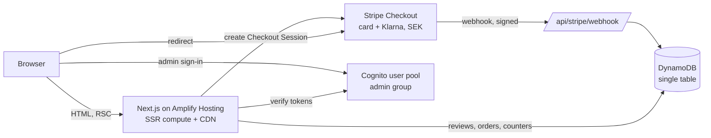

# Objekt: portfolio storefront

[Svenska](#svenska) · [English](#english)

**Live:** https://main.d9wg0b1285wyg.amplifyapp.com

A complete e-commerce storefront built as a portfolio project: Next.js and TypeScript on AWS Amplify, Stripe Checkout in test mode, orders and reviews in DynamoDB. The brand and products are made up. No real payments are taken.

---

## Svenska

### Vad det är

Objekt är en webbutik för ett påhittat varumärke med lampor, vaser, möbler och bordsartiklar. Varumärket och produkterna finns inte, bilderna genereras av ett skript och kassan körs mot Stripes testläge. Allt annat fungerar som i en riktig butik. Du kan välja varianter, lägga tillbehör i varukorgen till paketpris, betala med testkort eller Klarna och skriva recensioner. Ordern dyker upp i en adminvy, där den kan markeras som skickad.

All produktdata finns i en fil, [`src/data/products.ts`](src/data/products.ts). Ett nytt sortiment kräver alltså bara nya data och bilder.

### Testa ett köp

1. Välj en produkt och lägg den i varukorgen.
2. Betala med kortnumret `4242 4242 4242 4242`, ett framtida datum och valfri CVC. Klarna går också att välja i testläge, och rabattkoden `VALKOMMEN10` ger 10 %.
3. Stripe skickar en webhook. Servern kontrollerar signaturen och sparar ordern i DynamoDB.

### Funktionerna och varför de finns

| Funktion | Varför |
| --- | --- |
| Leveransdatum vid köpknappen, räknat från klockan i Stockholm med brytpunkt kl. 14, helger och svenska röda dagar | Kunden ser när varan kommer utan att leta i fraktvillkoren. |
| Köplist som dyker upp längst ner när köpknappen har scrollats bort | Den som har läst klart specifikationerna kan köpa direkt. |
| Mätare för fri frakt och ett förslag på tillbehör i varukorgen | Höjer ordervärdet, och frakten är aldrig en överraskning. |
| Tillbehör till paketpris ("Köp till och spara") | Rabatten räknas om på servern vid varje köp och går inte att manipulera från webbläsaren. |
| Färgprickar på produktkorten som visar produkten i den färgen | Kunden ser färgen innan hen klickar och landar direkt på rätt variant. |
| Kategorier som egna, förgenererade sidor och övriga filter i adressfältet | Kategorisidorna laddar snabbt från CDN:en och syns i sökmotorer. Filtrerade vyer går att dela och bakåtknappen tar bort senaste filtret. |
| A/B-test på köpknappen (B visar totalpriset) | Mäts per variant i adminvyn, för de besökare som godkänt statistik. |

Det här valde jag bort: nedräkningar, påhittade "tidigare priser", popup med lyckohjul, video som startar av sig själv och förifyllda recensioner. Statistik räknas först när besökaren har godkänt det, och båda knapparna i cookiebannern är lika stora. Sådana knep kan ge fler köp på kort sikt, men de kostar förtroende och gör siffrorna i ett A/B-test mindre pålitliga.

### Teknik i korthet

Next.js 15 (App Router) och TypeScript. Produktsidorna genereras statiskt och uppdateras var tionde minut och direkt när en recension kommer in. Kassan är Stripe Checkout med kort och Klarna i SEK. Backend är Amplify Gen 2 (Cognito för admin, en DynamoDB-tabell). Tester körs med Vitest och Playwright, och GitHub Actions kör allt vid varje push. Detaljerna finns på engelska nedan.

### Köra lokalt

```bash
npm install
npm run dev
```

Butiken startar utan AWS-konto och utan Stripe-nycklar. Kassan, recensionerna och adminvyn säger då själva att de inte är konfigurerade. Se [`.env.example`](.env.example).

---

## English

### What it is

Objekt is a storefront for a made-up homeware brand. The brand and products don't exist, the product images are generated by a script, and checkout runs against Stripe's test mode. Everything else works the way it would in a real shop. You can pick variants, add accessories at a bundle price, pay with a test card or Klarna, and leave a review. The order then shows up in an admin view, where it can be marked as shipped.

All product content lives in one file, [`src/data/products.ts`](src/data/products.ts), so a different product range only needs new data and images.

### Architecture



- **Next.js 15, App Router, TypeScript.** Product pages are statically generated with incremental revalidation (every 10 minutes, and immediately through `revalidateTag` when a review arrives). Each category is its own statically generated page (`/kollektion/vaser`), cached at the CDN and indexable. Colour, price, stock and sort live in the query string and apply in the browser through `useSearchParams`; the static HTML holds the unfiltered list, so the page works before JavaScript loads. Old `?kategori=` links redirect permanently.
- **Cart.** Pure pricing in [`src/lib/cart.ts`](src/lib/cart.ts), shared by the browser and the server. The checkout route recalculates every price from the catalogue and only trusts ids and quantities from the client. The cart is stored in `localStorage` and synced across tabs with `useSyncExternalStore`.
- **Stripe.** [`/api/checkout`](src/app/api/checkout/route.ts) creates a Checkout Session (card and Klarna, SEK, Swedish shipping). A line with a bundle discount is split into discounted and full-price units, because Stripe has no per-line discount for inline prices. Apple Pay and Google Pay appear through "card" in hosted Checkout, with no domain registration. Swish is in the allowed list too, but Stripe still offers it as a beta you request access to, so it only shows once Stripe enables it for the account. Promotion codes are on (the demo code `VALKOMMEN10` is listed openly on `/om-projektet`), and gift cards are applied as one-off Stripe coupons. [`/api/stripe/webhook`](src/app/api/stripe/webhook/route.ts) verifies the signature on the raw body and writes the order with a conditional put, so Stripe's retries can't create duplicates. It also handles Klarna's asynchronous success and failure events. Live keys are refused.
- **DynamoDB, single table.** Orders (with a GSI for the admin list), reviews with a per-product summary item updated in the same transaction, fixed-window rate limits keyed by salted IP hashes, and daily analytics counters. TTL expires the rate-limit and metrics items. See [`src/lib/server/db.ts`](src/lib/server/db.ts).
- **Amplify Gen 2 backend** in [`amplify/`](amplify/backend.ts). It defines the Cognito user pool (invite only, `admin` group), the table, and a least-privilege IAM role for the SSR compute that can only read and write that table.
- **Admin.** `/admin` checks the Cognito session on the server with Amplify's Next.js adapter and requires the `admin` group. Every server action checks it again. The admin view shows KPIs, a purchase funnel, A/B results, orders (paid → shipped) and review moderation.
- **Consent and analytics.** Nothing is tracked before opt-in, and the consent cookie is checked on the server too. Events are stored as anonymous daily counters. Purchases are counted by the webhook, per A/B arm.
- **SEO.** Canonical URLs, Open Graph images generated with `next/og`, and `ProductGroup` JSON-LD with per-variant offers, shipping and return policy. Ratings are only included when real reviews exist. The site also has Breadcrumb and FAQ JSON-LD, a sitemap and robots.txt. Filtered collection URLs share the category page's canonical URL.
- **Accessibility.** WCAG 2.2 AA. Native `<dialog>` drawers give focus trapping and Escape for free, radio groups make up the variant pickers, the skip link is the first tab stop, focus is visible, reduced motion is respected and touch targets are at least 24 px. Playwright runs axe on the key pages and walks the purchase flow with only the keyboard.

### Performance

Mobile Lighthouse on the live site (simulated phone): performance 96–98 on the home page, the collection, a category page and a product page, and 100 for accessibility, best practices and SEO. Fonts are self-hosted through `next/font`, CSS is inlined, the main product image is preloaded, and the shop pages ship about 120 kB of JavaScript. The admin sign-in bundle loads only on the admin pages.

### Tests

```bash
npm test            # Vitest: delivery dates, cart pricing, checkout items, filters, variants, review validation
npm run build
npm run test:e2e    # Playwright on desktop and Pixel 7: purchase flow, swatches, filters, consent, axe, keyboard
node scripts/screenshots.mjs <url> <dir>   # every page and UI state at phone and desktop size
```

The tests found real bugs during development. A price of 129,50 kr was shown as "129,5 kr". The filter radios in the sidebar and the mobile drawer shared a name, so ticking one unchecked the other. The cart's thumbnail link had no accessible name.

### Run locally

```bash
npm install
npm run dev
```

The shop runs without an AWS account or Stripe keys. Checkout, reviews and the admin view then say that they aren't configured. To use real backends, copy [`.env.example`](.env.example) to `.env.local`, and run `npx ampx sandbox` to deploy a personal Amplify backend.

### Deploy

1. Create an Amplify app connected to this repository. [`amplify.yml`](amplify.yml) deploys the backend and builds the site.
2. After the first deploy, attach the SSR role from `amplify_outputs.json` (`custom.computeRoleArn`) to the app as its compute role.
3. Add the environment variables `STRIPE_SECRET_KEY`, `STRIPE_WEBHOOK_SECRET`, `SITE_URL` and `HASH_SALT`.
4. In Stripe (test mode), add a webhook endpoint at `<SITE_URL>/api/stripe/webhook` for `checkout.session.completed`, `checkout.session.async_payment_succeeded` and `checkout.session.async_payment_failed`.
5. Invite an admin user in Cognito and add them to the `admin` group.

### Project layout

```
amplify/            Amplify Gen 2 backend (auth, table, SSR role)
scripts/            placeholder image generator, outputs stub
src/app/            routes: shop pages, /admin, /api, OG images, sitemap
src/components/     ui/ (design system), product/, cart/, collection/, reviews/, admin/
src/data/products.ts  the whole catalogue and shop settings
src/lib/            pure logic (cart, delivery, catalog, variants) and server/ (DynamoDB, Stripe, auth)
tests/              unit/ (Vitest) and e2e/ (Playwright)
```

Design reference: the Moooi palette (graphite, paper, cream, one blue accent, sand for selected states), with Hanken Grotesk and Jost in place of the commercial fonts.
