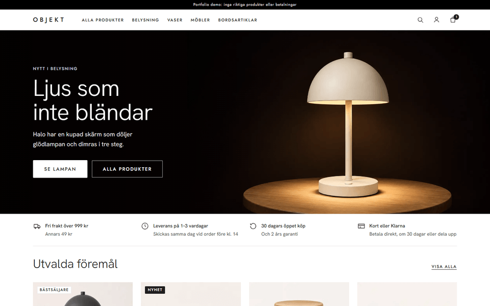
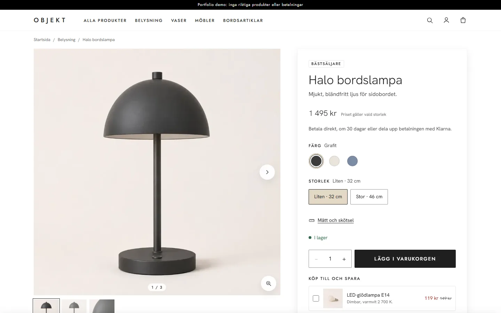
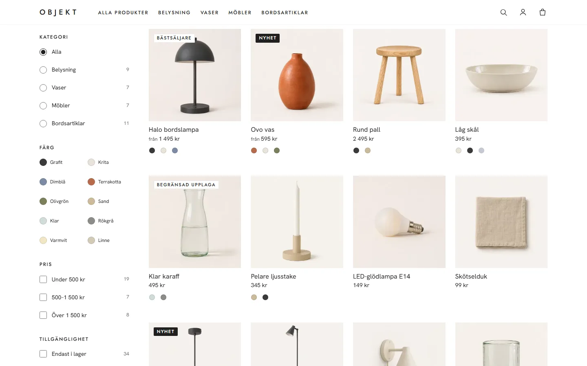
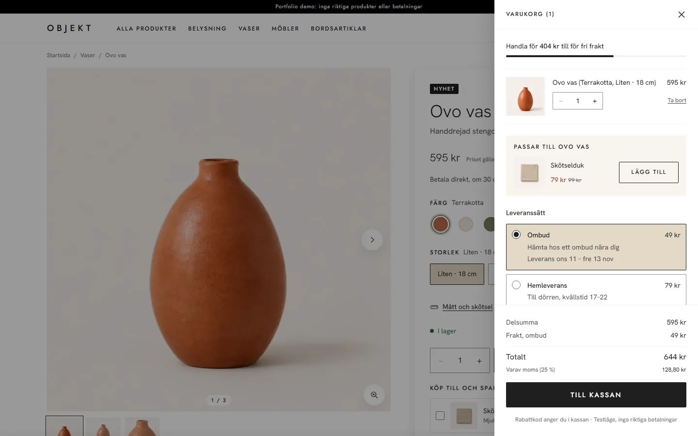
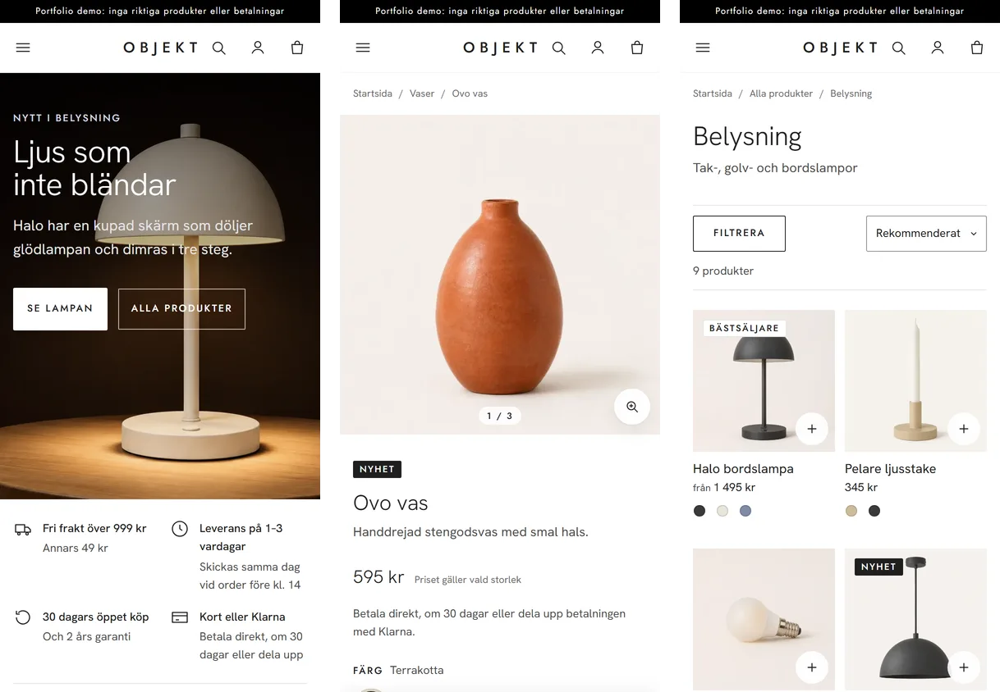

# Objekt: portfolio storefront

**Live:** https://objekt.live

A complete Swedish web shop for a made-up homeware brand, built as a portfolio project. Everything works the way it would in a real shop, except that payments run in Stripe's test mode and the products don't exist.



## What it does

**Shopping**
- 34 products with colour and size variants, AI-generated product photos for every colour, and a gallery with zoom
- Search with instant results, category pages, filters and sorting kept in the URL, quick add from product cards
- Add-ons at a bundle price, sets at a set price, "Passar bra med" and recently viewed products
- Back-in-stock alerts for sold-out variants, and reviews marked "Verifierat köp"

**Checkout and after**
- Cart drawer with free-shipping progress, pickup point, home or express delivery with delivery dates
- Stripe Checkout with card and Klarna, discount codes and gift cards (buy, redeem, partial balances)
- Order confirmation and receipts with Swedish VAT, order tracking, self-service returns and refunds
- Customer accounts with order history, "Köp igen", data export and account deletion
- Emails for every step: confirmation, shipping with tracking, returns, refunds, gift cards and an abandoned-cart reminder (only with marketing consent)

**Admin**
- Products, images and stock, edited live without a deploy
- Orders with shipping and tracking, returns, partial and full refunds through Stripe, cancellations with restock
- Gift cards, review moderation, a sales funnel and an A/B test

**Trust and compliance**
- Cookie banner with equal "Godkänn" and "Avböj" buttons; analytics only after consent
- Customer service with searchable FAQ, terms, a privacy policy that matches the code, and an accessibility statement
- No countdowns, fake "was" prices or pop-ups

## Screenshots

| Home | Product |
| --- | --- |
|  |  |

| Collection with filters | Cart |
| --- | --- |
|  |  |



## Built with

Next.js 15 (App Router, TypeScript) on AWS Amplify Gen 2, with DynamoDB, Cognito, S3 and CloudFront, SES for email and CloudWatch alarms. Payments through Stripe Checkout and signed webhooks.

Every push runs lint, type checks, unit tests (Vitest), end-to-end and accessibility tests (Playwright and axe, desktop and phone), screenshot comparisons and Lighthouse budgets (accessibility and SEO 100, performance 90 or more).

Design decisions are in [`docs/DECISIONS.md`](docs/DECISIONS.md) and the full change history in [`CHANGELOG.md`](CHANGELOG.md).

## Run locally

```bash
npm install
npm run dev
```

The shop runs without any keys; checkout, accounts and the admin say when they aren't configured.
