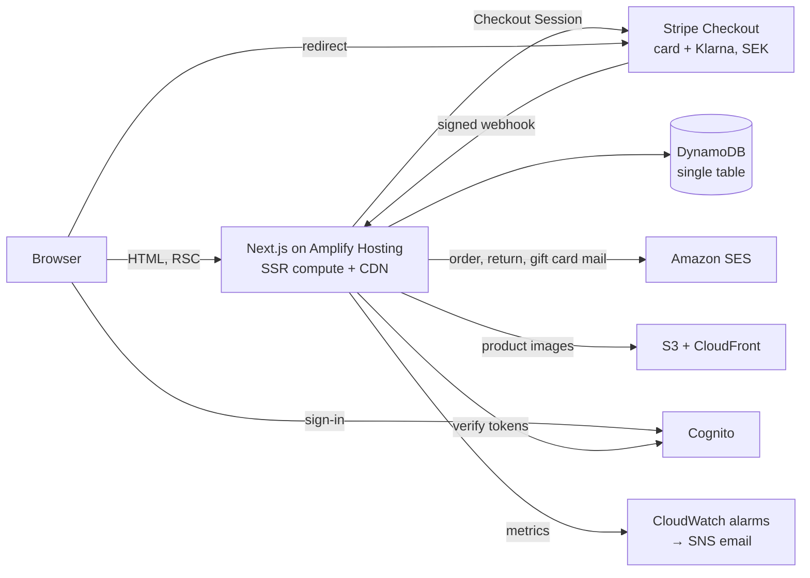

# Objekt: portfolio storefront

[Svenska](#svenska) · [English](#english)

**Live:** https://objekt.live

A complete web shop built as a portfolio project: Next.js and TypeScript on AWS Amplify, Stripe Checkout in test mode, DynamoDB, Cognito and SES. The brand and products are made up and no real payments are taken. Everything else works the way it would in a real shop.

---

## Svenska

### Vad det är

Objekt är en webbutik för ett påhittat varumärke med lampor, vaser, möbler och bordsartiklar: 34 produkter med färger och storlekar, bilder som genereras av ett skript och en kassa som körs mot Stripes testläge. En besökare kan hitta en produkt, köpa den med flera betalsätt och leveranssätt, följa paketet, returnera och få pengarna tillbaka. Den som driver butiken hanterar produkter, lager, ordrar och returer i en adminvy utan att något behöver driftsättas.

### Testa

1. Sök efter en produkt (snabbtangent `/`) eller bläddra i kollektionen, och lägg den i varukorgen.
2. Välj leveranssätt och ombud i varukorgen och gå till kassan.
3. Betala med kortnumret `4242 4242 4242 4242`, ett framtida datum och valfri CVC, eller med Klarna i testläge. Rabattkoden `VALKOMMEN10` ger 10 %.
4. Spåra ordern under Spåra order och anmäl en retur därifrån.

### Funktioner

| Område | Vad som finns |
| --- | --- |
| Hitta | Sök med direkta träffar, filter i adressfältet, kategorisidor, "Visa fler", favoriter, senast visade och "Passar bra med" |
| Välja | Färgprickar som visar produkten i rätt färg, snabbköp från korten, mått- och skötselguide, recensioner med "Verifierat köp", bevakning av slutsålda varianter |
| Köpa | Tillbehör till paketpris, set till setpris, ombud, hemleverans eller express med leveransdatum, presentkort, rabattkoder, kort och Klarna |
| Efter köpet | Orderbekräftelse, kvitto med moms, spårningslänk, returer och återbetalning via Stripe, konto med orderhistorik och "Köp igen" |
| Admin | Produkter och bilder, lager, ordrar med frakt och spårning, returer, avbrutna ordrar, presentkort, recensioner, försäljningstratt och A/B-test |
| Marknad | Produktflöden för Google och Meta, GA4-händelser efter samtycke, nyhetsbrev med dubbel bekräftelse |
| Förtroende | Kundservice med sökbara frågor och kontaktformulär, köpvillkor, integritetspolicy som stämmer med koden, tillgänglighetsredogörelse |

Det här valde jag bort: nedräkningar, påhittade "tidigare priser", popupfönster, video som startar av sig själv och förifyllda recensioner. Statistik räknas först när besökaren har godkänt det, och båda knapparna i cookierutan är lika stora. Sådana knep ger kanske fler köp i dag men kostar förtroende, och de gör siffrorna i ett A/B-test mindre pålitliga.

### Teknik i korthet

Next.js 15 med App Router och TypeScript. Produkt- och kategorisidorna genereras statiskt och uppdateras när något ändras. Backend är Amplify Gen 2 med Cognito, en DynamoDB-tabell, S3 och CloudFront för bilder och SES för e-post. Vitest och Playwright testar logik, flöden, tillgänglighet och utseende, och GitHub Actions kör allt vid varje push, inklusive Lighthouse. Detaljerna finns på engelska nedan och besluten i [`docs/DECISIONS.md`](docs/DECISIONS.md).

---

## English

### What it is

A storefront for a made-up homeware brand: 34 products with colours and sizes, generated images, and checkout against Stripe's test mode. A visitor can find a product, buy it with several payment and delivery methods, track it, return it and get a refund. The admin manages products, stock, orders and returns without a deploy. Progress per roadmap phase is in [`docs/PROGRESS.md`](docs/PROGRESS.md).

### Architecture



- **Catalogue.** Hand-written flagship products in [`src/data/products.ts`](src/data/products.ts) and the wider range as plain data in [`src/data/range.json`](src/data/range.json), which the image generator reads too. Once the admin saves a product, the catalogue lives in DynamoDB; products added to the files later still appear. Live stock is a separate item per variant, decremented by the webhook with a write that can't go below zero.
- **Pages.** Product and category pages are static with tag-based revalidation (catalogue, stock, reviews). Filters, sorting and "Visa fler" (`?sida=`) live in the URL and apply in the browser; the static HTML holds the first page, so it works before JavaScript loads. Search is a ranked scan in the browser with a server-rendered `/sok?q=` fallback.
- **Cart and pricing.** Pure functions in [`src/lib/cart.ts`](src/lib/cart.ts) shared by browser and server: bundle prices, set prices spread over lines in whole öre, delivery method fees. The checkout route re-prices everything from the catalogue and only trusts ids, quantities, the delivery choice and a gift card code, all validated on the server.
- **Stripe.** [`/api/checkout`](src/app/api/checkout/route.ts) creates one Checkout Session with a single validated shipping rate. Payment is limited to card and Klarna. Promotion codes are on, and a gift card becomes a one-off coupon for that session. [`/api/stripe/webhook`](src/app/api/stripe/webhook/route.ts) verifies the signature, writes orders idempotently, takes stock and gift card balances with conditional writes, issues purchased gift cards and handles Klarna's asynchronous events. Refunds (returns, cancellations) call Stripe with idempotency keys before saving. Live keys are refused.
- **Orders after payment.** Shipping with carrier and tracking number, returns at `/retur/<order>` (signed link or account), partial and full refunds, cancellations with restock. Every step is written to an order history shown to admin and customer. Updates use optimistic locking on the order item.
- **Accounts.** Cognito sign-up with email verification. Orders link to the account through `client_reference_id`; guest orders can be claimed with a verified email. Customers can export their data and delete the account; their orders are then anonymised.
- **Email.** SES templates for confirmations, shipping, returns, refunds, cancellations, gift cards, back-in-stock and newsletter double opt-in, each newsletter mail with a one-click unsubscribe. SES is in sandbox mode, so mail only reaches verified addresses.
- **Marketing.** Google Merchant and Meta feeds at `/feeds/google.xml` and `/feeds/meta.csv`. GA4 ecommerce events go to `dataLayer` only after consent; Google Tag Manager with Consent Mode v2 loads only when `NEXT_PUBLIC_GTM_ID` is set.
- **Security.** A Content Security Policy that allows only Stripe, Cognito and (when configured) Google's tag hosts, HSTS, frame denial and a strict referrer policy. Server actions re-check the admin session. Forms are rate-limited with salted IP hashes and have honeypots.
- **Monitoring.** CloudWatch alarms on Amplify 5xx errors and on a custom metric the webhook reports when it fails, emailing an SNS subscriber.
- **Accessibility.** WCAG 2.2 AA as the target: native `<dialog>` drawers, radio-group variant pickers, a combobox search, visible focus, reduced motion. What has and hasn't been tested is on `/tillganglighet`.

### Quality gates

```bash
npm test             # Vitest: pricing, sets, shipping, returns and refunds, gift cards, feeds, search, filters, accounts
npm run build
npm run test:e2e     # Playwright, desktop and Pixel 7: purchase, delivery, search, quick add, sets, consent, CSP, axe, keyboard
npm run test:visual  # screenshot comparisons (baselines rendered in CI)
node scripts/screenshots.mjs <url> <dir>   # every page and UI state for manual review
```

GitHub Actions runs lint, type-check, unit tests, build, end-to-end tests, screenshot comparisons and Lighthouse CI (accessibility and SEO 100, performance at least 90 on the shared runner, layout shift under 0.05). Mobile Lighthouse on the live site: 96 for performance and 100 for accessibility, best practices and SEO on the home, collection and product pages. Amplify builds a preview with its own backend for every pull request.

### Run locally

```bash
npm install
npm run dev
```

The shop runs without an AWS account or Stripe keys; checkout, accounts and the admin say they aren't configured. Copy [`.env.example`](.env.example) to `.env.local` and run `npx ampx sandbox` for real backends.

### Deploy

1. Connect an Amplify app to the repository. [`amplify.yml`](amplify.yml) deploys the backend and builds the site.
2. Attach the SSR role from `amplify_outputs.json` (`custom.computeRoleArn`) as the app's compute role.
3. Set `STRIPE_SECRET_KEY`, `STRIPE_WEBHOOK_SECRET`, `SITE_URL`, `HASH_SALT`, `RECEIPT_SECRET` and `EMAIL_FROM`; optionally `NEXT_PUBLIC_STRIPE_PUBLISHABLE_KEY`, `NEXT_PUBLIC_GTM_ID`, `CONTACT_TO` and `ALERT_EMAIL`.
4. Add a Stripe webhook destination for `checkout.session.completed`, `checkout.session.async_payment_succeeded` and `checkout.session.async_payment_failed`.
5. Invite an admin in Cognito, add them to the `admin` group, and confirm the SNS alert subscription email.

### Project layout

```
amplify/            Amplify Gen 2 backend: auth, table, image bucket and CDN, SSR role, alarms
scripts/            image generator, screenshots, lockfile check
src/app/            shop pages, /konto, /admin, /api, feeds, legal pages
src/components/     ui/ (design system) and feature folders (product, cart, search, collection, …)
src/data/           catalogue, range, sets, customer service content
src/lib/            pure logic (cart, shipping, returns, gift cards, search, feeds) and server/ (DynamoDB, Stripe, SES, auth)
tests/              unit/ (Vitest), e2e/ (Playwright), visual/ (screenshot baselines)
docs/               decisions, progress, roadmap prompts
```

Design reference: the Moooi palette (graphite, paper, cream, one blue accent, sand for selected states), with Hanken Grotesk and Jost in place of the commercial fonts.
